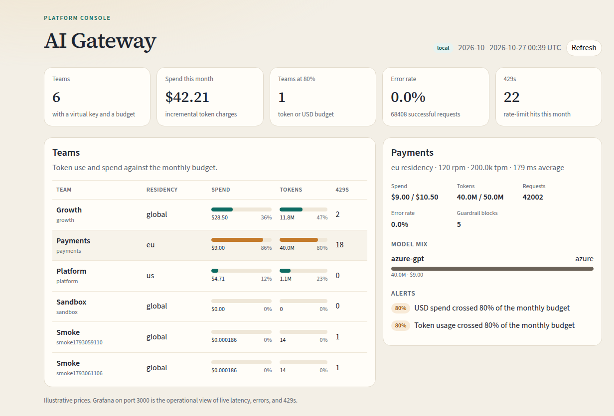
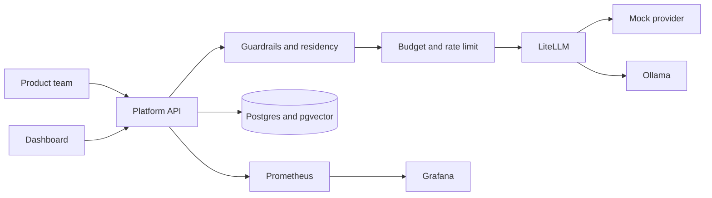
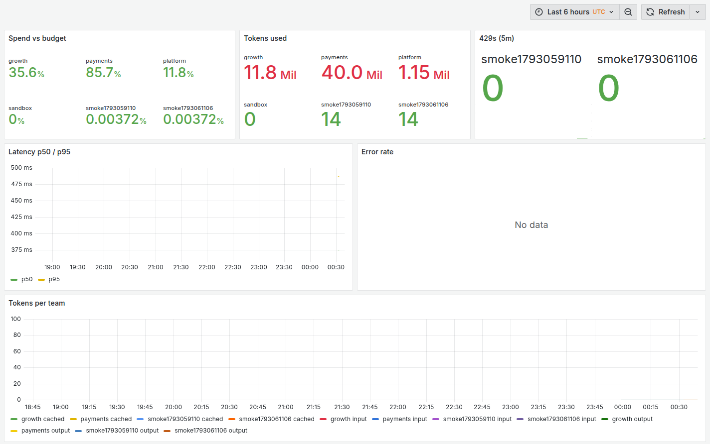

# Multicloud AI Gateway

[](https://github.com/AndreGalvez03/multicloud-ai-gateway/actions/workflows/ci.yml)
[](LICENSE)

An internal platform for product teams that need a model, a budget, and an answer to "where did this prompt go."



Teams call one OpenAI-shaped API. The platform checks the virtual key, redacts or blocks the prompt, picks a model that matches the team's residency, and stops the call if it would break the monthly token or dollar budget. [LiteLLM](litellm/config.yaml) then talks to Amazon Bedrock, Vertex AI, Azure AI Foundry, or a self-hosted model. Locally those cloud names are an OpenAI-compatible mock, so the whole path runs with Docker and no cloud account.

Grafana is the operational view. The small TypeScript console is the monthly view a product team actually reads.

## Architecture



In AWS the same boxes run on a private EKS cluster. The gateway pod uses IRSA to call Bedrock. Vertex trusts that EKS issuer through a Workload Identity pool. Azure AI Foundry trusts it with a user-assigned identity and a federated credential, a private endpoint, and an Entra ID group. Humans get a read permission set, an account assignment, and an explicit deny on `bedrock:InvokeModel`. See [docs/adr](docs/adr).

## What you can try

- Per-team RPM, TPM, monthly token budget, and monthly USD budget, with alerts at 80% and 100%.
- Input, output, and cache-read prices, plus a batch factor and a provisioned-throughput commitment. The worked example is in [docs/cost-model.md](docs/cost-model.md).
- Residency: an EU team cannot be routed to a US model, including by fallback.
- Guardrails: email, phone, SSN, and card redaction, and a blocked-topic list checked before redaction.
- A minimal RAG path: chunk a document, store a 64-d hash embedding in pgvector, and answer from that context.
- An MCP endpoint with read-only tools `get_team_usage` and `list_models`.
- The `aigw` CLI, and ops scripts for health, key rotation, and a smoke test.

## Quickstart

```bash
git clone https://github.com/AndreGalvez03/multicloud-ai-gateway.git
cd multicloud-ai-gateway
make up
./scripts/smoke-test.sh
```

Then open the dashboard at <http://localhost:5173>, Grafana at <http://localhost:3000> (anonymous Viewer), and Prometheus at <http://localhost:9090>. The platform API is on port 8080, LiteLLM on 4000, and the mock's fault switch on 8088.



`make up` builds the images and waits until the health check passes. It does not pull a Llama weight. `make pull-model` fetches `llama3.2` into Ollama if you want the self-hosted route for real.

A usage report, once `pip install -e .` has put the CLI on your path:

```bash
export AIGW_BASE_URL=http://127.0.0.1:8080
aigw usage --team payments
```

Seeded keys, all local fixtures: `local-vk-payments` (EU), `local-vk-growth` (global), `local-vk-platform` (US), `local-vk-sandbox` (3 RPM, useful for a 429). Admin token: `local-admin-token`.

## Dashboard

The console reads `GET /v1/dashboard/summary`. Payments is selected on load because it is closest to its dollar budget. The nginx proxy for that one GET does not hold the admin token.

## Skills demonstrated

| Skill | Where it shows up |
| --- | --- |
| Python, TypeScript, and Bash | `aigw/`, `dashboard/`, `scripts/` |
| Terraform on AWS, with a smaller GCP and Azure footprint | `infra/terraform/aws`, `infra/terraform/gcp`, `infra/terraform/azure` |
| Private EKS, Helm, and kind | `infra/terraform/aws/modules/eks`, `deploy/helm/aigw`, `scripts/kind-up.sh` |
| Bedrock, Vertex from EKS, and Azure AI Foundry | `infra/terraform/aws/modules/bedrock`, `infra/terraform/gcp`, `infra/terraform/azure` |
| Token pricing, prompt caching, batch, and provisioned throughput | `aigw/pricing.py`, `aigw/catalog.py`, `docs/cost-model.md` |
| Budgets, RPM/TPM, guardrails, and residency | `aigw/holds.py`, `aigw/ratelimit.py`, `aigw/guardrails.py`, `aigw/routing.py` |
| LiteLLM gateway and a self-hosted model path | `litellm/config.yaml`, `local-llama` in the catalog |
| IAM Identity Center and Entra ID | `infra/terraform/aws/modules/identity`, `infra/terraform/azure` |
| Prometheus, Alertmanager, Grafana, and CloudWatch | `observability/`, `infra/terraform/aws/modules/observability` |
| MCP tools for usage and the model catalog | `aigw/mcp.py` |

[ADR 0004](docs/adr/0004-identity.md) describes how a group from another identity provider would map onto the same team record. The gateway would still be the only caller of Bedrock.

## Secrets

Nothing in git is a cloud credential. `.env.example` lists the compose fixtures. gitleaks runs in CI with those fixtures allowlisted.

In a real account:

- Bedrock is called with IRSA. There is no Bedrock API key.
- Vertex uses a Workload Identity pool that trusts the EKS issuer. Azure uses a user-assigned identity with a federated credential, and local key auth on the cognitive account is disabled.
- A third-party provider key lives in AWS Secrets Manager at `aigw/providers`. Terraform creates the secret and does not set a value. The chart sets `AIGW_SECRETS_MANAGER_SECRET` to that name and can mount the External Secrets projection `ai-gateway-providers`. The chart does not install that CRD.

## What is intentionally simplified

- Cloud model names are served by the mock. `litellm/config.yaml` has the real `bedrock/`, `vertex_ai/`, and `azure/` blocks commented above the mock entries.
- Terraform is validated (`make tf-validate`) and never applied.
- Prices are illustrative. The `$0.00045000` example is tested, not quoted from a provider.
- Batch mode is `POST /v1/batch/chat` for a team that is allowed to use it. It is not the Bedrock batch API. Provisioned throughput is an hourly commitment in the catalog plus a Terraform resource that is off by default.
- The budget reservation is one conditional UPDATE. The rate-limit window is still racy across replicas. ADR 0003 names that follow-up.
- `make up` starts Ollama and does not download a weight.
- The EKS module has one NAT gateway. Production wants one per AZ.
- Identity Center groups are created only when the instance ARN and identity store id are supplied.

## Layout

```
aigw/                 platform API, pricing, routing, guardrails, MCP, CLI
litellm/              proxy config
services/mock-provider
dashboard/            Vite + React console
observability/        Prometheus rules and Grafana dashboard
deploy/helm/aigw      chart
deploy/kind           local cluster
infra/terraform       aws, gcp, azure
docs/adr              decisions
docs/runbooks         429s, Bedrock throttling, budget, outage, latency
scripts/              health, smoke, key rotation, kind, screenshot
```

## License

MIT. See [LICENSE](LICENSE).
